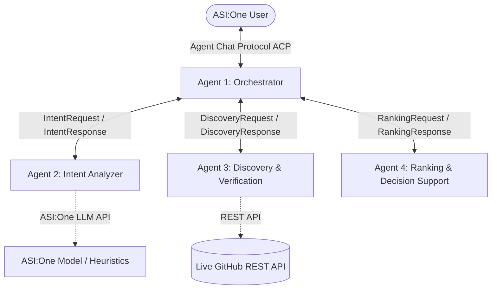
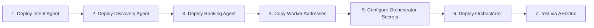

# 🛰️ RepoRadar

> **Search less. Verify more. Build with confidence.**

RepoRadar is a multi-agent AI system designed for **Fetch-A-Thon 3.0 (ASI:One Agent Challenge)**. It helps developers, researchers, and engineers discover, verify, compare, and select open-source software based on natural-language requirements directly through **ASI:One**.

Rather than returning popular repositories based merely on star counts, RepoRadar interprets user requirements, searches GitHub in real time, inspects repository documentation and metadata, performs evidence-based feature verification, filters out incompatible candidates, ranks the surviving options using an explainable multi-factor scoring model, and provides transparent recommendations with direct evidence links.

---

## 🏗️ Architecture Overview

RepoRadar is built as a decentralized multi-agent system comprising **exactly four independently deployable Python agents**:



### Agent Roles & Responsibilities

| Agent File | Role | Primary Responsibilities |
|---|---|---|
| [`agents/1_orchestrator.py`](agents/1_orchestrator.py) | **Orchestrator Agent** | Public ASI:One chat entry point (`AgentChatProtocol`), task state tracker, worker coordinator, clarification handler, timeout enforcement, and decision report formatter. |
| [`agents/2_intent_agent.py`](agents/2_intent_agent.py) | **Intent Analyzer Agent** | Natural-language query parsing, constraint extraction (distinguishing mandatory constraints from preferences), platform/licensing classification, and complementary GitHub search query generation. |
| [`agents/3_discovery_agent.py`](agents/3_discovery_agent.py) | **Discovery & Verification Agent** | Live GitHub repository search, metadata collection, README retrieval, and evidence-based verification (`verified`, `not_supported`, `unknown`). |
| [`agents/4_ranking_agent.py`](agents/4_ranking_agent.py) | **Ranking & Decision Support Agent** | Hard constraint filtering, 5-factor explainable scoring, trade-off analysis, and recommendation generation. |

All four agents communicate exclusively through **uAgents message dispatch** over the Fetch.ai network. No shared runtime database, shared Python modules, or local function call shortcuts are used.

---

## 📁 Repository Structure

```text
reporadar/
├── agents/
│   ├── 1_orchestrator.py       # Orchestrator & ASI:One Chat interface
│   ├── 2_intent_agent.py       # Intent extraction & query generator
│   ├── 3_discovery_agent.py    # GitHub REST discovery & verification
│   └── 4_ranking_agent.py      # Hard filtering & multi-factor ranking
├── .gitignore                  # Standard exclusions (secrets, caches)
├── requirements.txt            # Minimal runtime dependencies
├── README.md                   # Deployment & usage guide
└── LICENSE                     # Apache 2.0 License
```

> [!IMPORTANT]
> **Strict Standalone Requirement:** Each of the four agent files is self-contained and copy-pasteable into a blank **Agentverse** agent editor. Models are intentionally duplicated across files so that each agent can be deployed independently without external project dependencies.

---

## 🔬 How Evidence Verification & Ranking Work

### 1. Evidence-Based Verification (Agent 3)

RepoRadar adheres to strict verification principles:

* **`verified`**: The repository documentation, README, topics, or metadata explicitly confirm support for the feature or platform (accompanied by an excerpt and evidence URL).
* **`not_supported`**: Clear evidence exists that the candidate does not support the requirement (e.g. documentation stating *"Windows only"* when Linux was requested).
* **`unknown`**: The repository documentation makes no explicit mention of the capability. Missing documentation is marked as `unknown`, **never** as `not_supported`.
* **License Integrity**: A repository on GitHub is not assumed to be open source unless confirmed by SPDX metadata or an explicit license file.
* **Untrusted Data Policy**: All repository documentation is treated as untrusted text data. Code, build scripts, or binaries are **never** executed.

### 2. Multi-Factor Explainable Scoring (Agent 4)

Surviving candidates are scored on a normalized **0–100 scale** using deterministic weights:

$$\text{Score} = (\text{Relevance} \times 0.40) + (\text{Features} \times 0.25) + (\text{Maintenance} \times 0.15) + (\text{Popularity} \times 0.10) + (\text{DocUsability} \times 0.10)$$

| Criterion | Weight | Scoring Mechanism |
|---|---:|---|
| **Relevance** | **40%** | Category alignment, domain keywords, and core problem match in description and topics. |
| **Feature Compatibility** | **25%** | Ratio of verified mandatory features (`verified` = 1.0, `unknown` = 0.25, `not_supported` = 0.0) plus preferred feature bonus. |
| **Maintenance Signals** | **15%** | Commit recency ($\le 90\text{ days} = 1.0$, $\le 180\text{ days} = 0.8$, $\le 365\text{ days} = 0.6$, older decayed). Archived projects receive 0.0. |
| **Popularity Signals** | **10%** | Logarithmically scaled community adoption: $\min(1.0, \frac{\log_{10}(\text{stars} + 1)}{4.5})$. Popularity never overrides mandatory constraints. |
| **Documentation & Usability** | **10%** | Structured README presence (0.4), verified open-source license (0.3), and skill level alignment (e.g. GUI, tutorials, beginner guides) (0.3). |

---

## 🔐 Environment Variables & Secrets

All configuration is provided via environment variables or Agentverse secrets using `os.getenv()`. No `.env` file is required.

### Agent 1: Orchestrator
* `AGENT_SEED`: *(Optional)* Secret seed phrase for consistent agent address.
* `INTENT_AGENT_ADDRESS`: Deployed address of Agent 2 (`agent1q...`).
* `DISCOVERY_AGENT_ADDRESS`: Deployed address of Agent 3 (`agent1q...`).
* `RANKING_AGENT_ADDRESS`: Deployed address of Agent 4 (`agent1q...`).
* `TASK_TIMEOUT_SECONDS`: *(Optional, default: `90`)* Maximum time allocated for the pipeline before notifying the user of a timeout.

### Agent 2: Intent Analyzer
* `AGENT_SEED`: *(Optional)* Secret seed phrase.
* `ASI1_API_KEY`: API token from [asi1.ai](https://asi1.ai/dashboard/api-keys).
* `ASI1_BASE_URL`: *(Optional, default: `https://api.asi1.ai/v1`)*.
* `ASI1_MODEL`: *(Optional, default: `asi1-mini`)*.

### Agent 3: Discovery & Verification
* `AGENT_SEED`: *(Optional)* Secret seed phrase.
* `GITHUB_TOKEN`: *(Optional, but recommended)* GitHub Personal Access Token (raises rate limit from 60 to 5,000 requests/hour).
* `GITHUB_MAX_QUERIES`: *(Optional, default: `3`)* Maximum search queries executed per request.
* `GITHUB_RESULTS_PER_QUERY`: *(Optional, default: `5`)* Number of candidates inspected per query.
* `REQUEST_TIMEOUT_SECONDS`: *(Optional, default: `10`)* GitHub API request timeout.
* `MAX_RETRIES`: *(Optional, default: `2`)* Retry attempts for transient errors.

### Agent 4: Ranking & Decision Support
* `AGENT_SEED`: *(Optional)* Secret seed phrase.

---

## 🚀 Agentverse Deployment Guide

Deploy the agents in this exact sequence:



### Step 1: Deploy Worker Agents (Agents 2, 3, and 4)

1. Log in to [Agentverse](https://agentverse.ai/).
2. Navigate to **My Agents** and click **+ New Agent** -> **Blank Agent**.
3. Create three separate agents:
   * **RepoRadar-Intent**: Copy and paste the entire contents of [`agents/2_intent_agent.py`](agents/2_intent_agent.py).
   * **RepoRadar-Discovery**: Copy and paste the entire contents of [`agents/3_discovery_agent.py`](agents/3_discovery_agent.py).
   * **RepoRadar-Ranking**: Copy and paste the entire contents of [`agents/4_ranking_agent.py`](agents/4_ranking_agent.py).
4. Configure secrets for each agent in the Agentverse **Secrets** panel:
   * On **RepoRadar-Intent**, add `ASI1_API_KEY` (and optionally `ASI1_BASE_URL`, `ASI1_MODEL`).
   * On **RepoRadar-Discovery**, add `GITHUB_TOKEN`.
5. Click **Start** (or **Run**) on each agent.

### Step 2: Retrieve Worker Addresses

Once started, each agent displays its Fetch.ai address (format: `agent1q...`). Copy these three addresses:
* Intent Agent address
* Discovery Agent address
* Ranking Agent address

### Step 3: Configure and Deploy the Orchestrator (Agent 1)

1. In Agentverse, create a fourth blank agent named **RepoRadar-Orchestrator**.
2. Copy and paste the entire contents of [`agents/1_orchestrator.py`](agents/1_orchestrator.py).
3. In the **Secrets** panel for the Orchestrator, add:
   * `INTENT_AGENT_ADDRESS`: *<address of Agent 2>*
   * `DISCOVERY_AGENT_ADDRESS`: *<address of Agent 3>*
   * `RANKING_AGENT_ADDRESS`: *<address of Agent 4>*
4. Click **Start** on the Orchestrator.

### Step 4: Test in ASI:One

1. Open [ASI:One Chat](https://asi1.ai/chat).
2. Direct a message to your Orchestrator agent or search for your registered agent in the Agentverse directory.
3. Test with a query such as:
   > *"I need free, open-source circuit design software. I use Linux, I'm a beginner, and I need schematic design, circuit simulation, and PCB layout."*
4. Verify that RepoRadar:
   - Immediately acknowledges message receipt via the Agent Chat Protocol.
   - Coordinates with the Intent, Discovery, and Ranking worker agents.
   - Dispatches a verified recommendation report with direct repository links, scores, feature evidence, and limitation caveats.

---

## 🛠️ Troubleshooting & Common Issues

| Symptom | Cause | Solution |
|---|---|---|
| `⚠️ Orchestrator is missing required worker agent addresses` | One or more worker addresses are not set in the Orchestrator's secrets. | Set `INTENT_AGENT_ADDRESS`, `DISCOVERY_AGENT_ADDRESS`, and `RANKING_AGENT_ADDRESS` in the Orchestrator's Agentverse secrets. |
| `⏱️ Workflow Timeout during stage...` | A worker agent is stopped or took too long to respond. | Verify all three worker agents are running in Agentverse. Check logs for rate limits or API errors. |
| `GitHub API rate limit exceeded` | Unauthenticated GitHub rate limit (60 requests/hr) reached. | Add a `GITHUB_TOKEN` secret to the Discovery Agent to enable 5,000 requests/hr. |
| Intent extractor uses fallback | `ASI1_API_KEY` is unset or invalid. | The agent automatically falls back to its built-in rule-based extractor. To use the LLM, verify your `ASI1_API_KEY` secret. |
| `No Matching Repositories Discovered` | Constraints are too narrow or keywords did not yield results. | Try relaxing strict platform or license filters, or broaden the feature terms. |

---

## 📦 Local Git Initialization & Pushing

To initialize and push this codebase to your team's GitHub repository:

```bash
# 1. Initialize local repository (if not already initialized)
git init

# 2. Stage files (review files first)
git add agents/ .gitignore requirements.txt README.md LICENSE

# 3. Create initial commit
git commit -m "feat: initial RepoRadar multi-agent system for ASI:One"

# 4. Link your team remote and push
git branch -M main
git remote add origin https://github.com/<your-org-or-username>/<your-repo-name>.git
git push -u origin main
```

---

## 📄 License

This project is licensed under the **Apache License 2.0**. See the [LICENSE](LICENSE) file for details.
